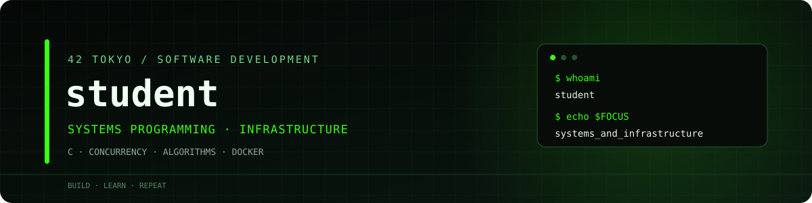

  

## 🟢 About

I build software in C, Python, and Go at 42 Tokyo, focusing on network programming, algorithms, and containerized infrastructure.

42 Tokyoの課題を通じて、C・Python・Goを使ったネットワークプログラミング、アルゴリズム、コンテナ環境の構築に取り組んでいます。

## 🟢 Tech Stack

<table align="center">
  <tr>
    <td align="center" width="88"> C</td>
    <td align="center" width="88"> Python</td>
    <td align="center" width="88"> Go</td>
    <td align="center" width="88"> Shell</td>
    <td align="center" width="88"> Linux</td>
    <td align="center" width="88"> Docker</td>
  </tr>
</table>

<table align="center">
  <tr>
    <td align="center" width="88"> Git</td>
    <td align="center" width="88"> GitHub</td>
    <td align="center" width="88"> Vim</td>
    <td align="center" width="88"> VS Code</td>
    <td align="center" width="88"> K3s</td>
  </tr>
</table>

| Category | Technologies |
| --- | --- |
| Languages | C / Python / Go / Shell / x86-64 Assembly |
| Infrastructure | Docker / Docker Compose / K3s |
| Development | Git / Make / Vim / VS Code |

## 🟢 Featured Projects

- **[The Answer Protocol](https://github.com/kawakawa42Tokyo202604/Tap)** — Go / TCP / Fyne 
  Multiplayer adventure with a TCP server, terminal and graphical clients, and JSON save files. 
  ギリシャ神話の世界を探索するマルチプレイゲーム。TCPサーバーとCLI・GUIを実装し、プレイヤーの状態をJSONに保存します。
- **[Fly-in](https://github.com/kawakawa42Tokyo202604/FlyIn)** — Python / Pathfinding 
  Multi-drone route planning with time and location as search states and capacity limits on locations and connections. 
  地点と時刻を組み合わせて探索し、各地点・経路の台数制限を守りながら複数のドローンの移動を計画します。
- **[Call Me Maybe](https://github.com/kawakawa42Tokyo202604/CallMeMaybe)** — Python / LLM / JSON 
  Generate function names and arguments as JSON using a custom tokenizer and constrained decoding. 
  自作のトークナイザーと制約付きデコードを使い、文章の指示から関数名と引数をJSONで生成します。
- **[Codexion](https://github.com/kawakawa42Tokyo202604/Codexion)** — C / POSIX Threads 
  Simulate developers sharing equipment with FIFO and earliest-deadline-first scheduling. 
  共有機器を利用する開発者をPOSIXスレッドでシミュレートし、要求順（FIFO）または期限が近い順（EDF）で機器を割り当てます。
- **[Inception](https://github.com/kawakawa42Tokyo202604/Inception)** — Docker / Docker Compose / Shell 
  Run NGINX, WordPress, and MariaDB in separate containers with HTTPS, persistent volumes, and backup restore checks. 
  NGINX・WordPress・MariaDBを個別のコンテナで動かし、HTTPS・永続ボリューム・バックアップの復元検証を組み合わせています。
- **[push_swap](https://github.com/kawakawa42Tokyo202604/PushSwap)** — C / Sorting algorithms 
  Choose a two-stack sorting strategy based on input size and disorder, with a checker for the generated operations. 
  入力の件数と並び方に応じて2つのスタックを使うソート戦略を選び、出力した操作列を`checker`で検証できます。

Public 42 Tokyo projects / 公開課題一覧

| Project | Language / Technology | About |
| --- | --- | --- |
| [libft](https://github.com/kawakawa42Tokyo202604/Libft) | C | 標準Cライブラリの基本関数、文字列ユーティリティ、連結リスト操作をまとめた自作ライブラリ。 |
| [ft_printf](https://github.com/kawakawa42Tokyo202604/FtPrintf) | C | 書式指定文字列を解析し、文字列・数値・ポインタなどを出力する`printf`の一部を再実装。 |
| [get_next_line](https://github.com/kawakawa42Tokyo202604/GetNextLine) | C | ファイルディスクリプタから1行ずつ読み取る関数。ボーナスでは複数の読み取り対象の状態を管理。 |
| [push_swap](https://github.com/kawakawa42Tokyo202604/PushSwap) | C | スタック操作によるソート、複数戦略の選択、命令数の計測、`checker`による結果確認。 |
| [Python modules 00–10](https://github.com/kawakawa42Tokyo202604/PythonModule) | Python | 基本文法、オブジェクト指向、例外処理、ファイル入出力、パッケージ、Pydantic、デコレータを学ぶ課題群。 |
| [A-Maze-ing](https://github.com/kawakawa42Tokyo202604/AMazeIng) | Python | 設定ファイルから迷路を生成し、入口から出口への経路を探索・出力するプログラム。 |
| [A-Maze-ing bonus](https://github.com/kawakawa42Tokyo202604/AMazeIngBonus) | Python | DFS / Kruskalの生成アルゴリズム切り替え、対話式の表示操作、再利用可能なパッケージ化。 |
| [Codexion](https://github.com/kawakawa42Tokyo202604/Codexion) | C / POSIX Threads | 共有リソースの同期、FIFO / EDFの待ち行列、期限の監視を組み合わせた並行処理シミュレーション。 |
| [Inception](https://github.com/kawakawa42Tokyo202604/Inception) | Docker / Shell | 自作コンテナによるWebインフラと、TLS・永続化・キャッシュ・バックアップ・復元検証。 |
| [The Answer Protocol](https://github.com/kawakawa42Tokyo202604/Tap) | Go / TCP / Fyne | 複数人で探索・会話・戦闘を楽しむゲーム。サーバーとCLI・GUIクライアントを実装。 |
| [Call Me Maybe](https://github.com/kawakawa42Tokyo202604/CallMeMaybe) | Python / LLM | 文章の指示を、関数名と引数を持つJSONデータへ変換。 |
| [Fly-in](https://github.com/kawakawa42Tokyo202604/FlyIn) | Python / Pathfinding | 地点・経路の容量と移動時間を考慮し、複数ドローンの移動を計画。 |
| [Dr Quine](https://github.com/kawakawa42Tokyo202604/DrQuine) | C / Assembly / Go | 自分のソースを表示・保存・連鎖生成する自己複製プログラム。 |
| [libasm](https://github.com/kawakawa42Tokyo202604/Libasm) | x86-64 Assembly | Cから呼び出せる文字列・メモリ・ファイル入出力の基本関数集。 |
| [NetPractice](https://github.com/kawakawa42Tokyo202604/NetPractice) | TCP/IP / Networking | IP・サブネット・経路設定の10レベルのネットワーク演習。 |
| [Packman](https://github.com/kawakawa42Tokyo202604/Packman) | Python / pygame | 外部迷路生成器と組み合わせたパックマンゲーム。 |
| [RAG](https://github.com/kawakawa42Tokyo202604/Rag) | Python / BM25 / LLM | コードベースを検索し、根拠に基づいて回答するRAGパイプライン。 |
| [AgentSmith](https://github.com/kawakawa42Tokyo202604/AgentSmith) | Python / LLM / Sandbox | コード生成・実行・検証を繰り返す開発支援エージェント。 |

## 🟢 GitHub Stats

  

  
  

  

